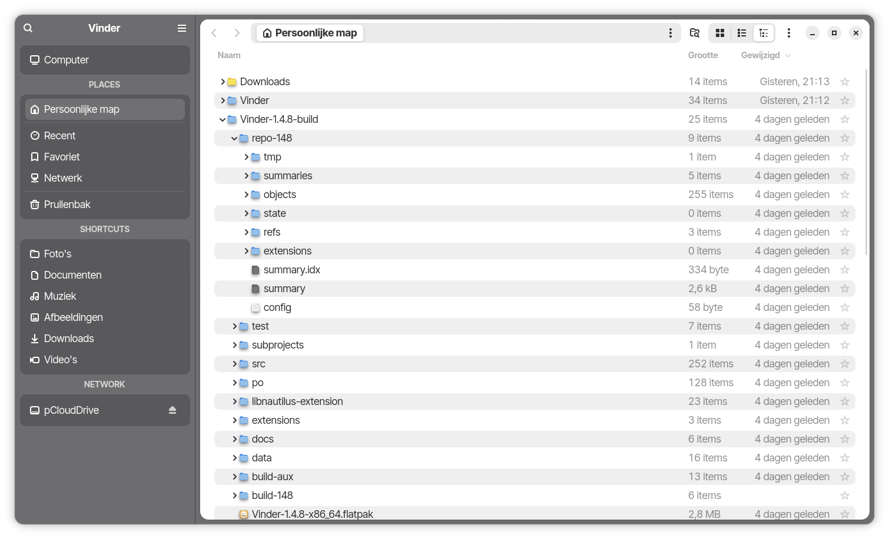
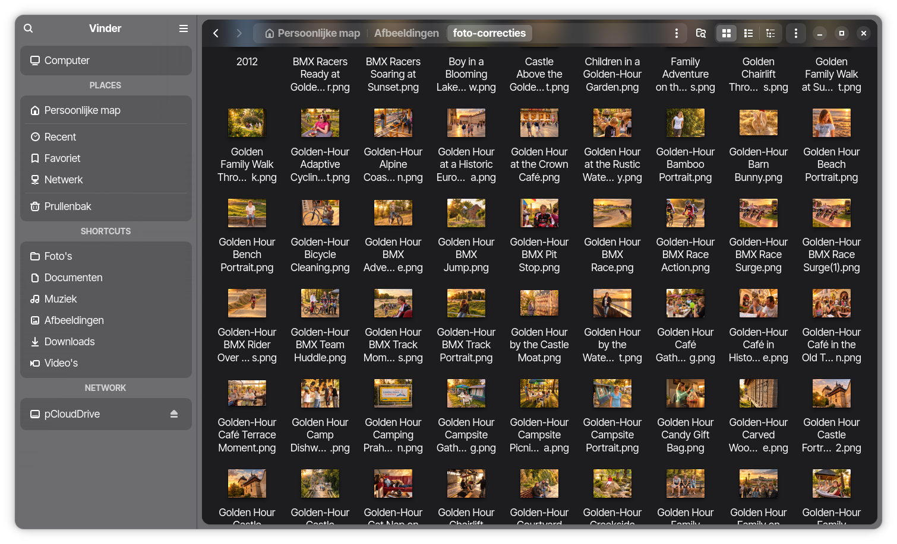
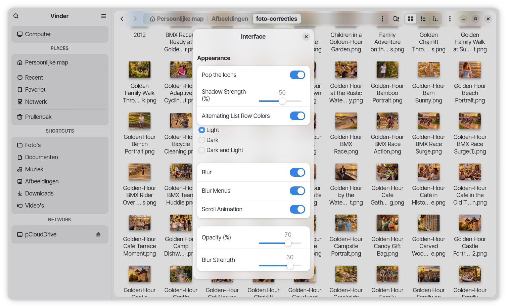

# Vinder

Vinder is a file manager for GNOME, based on [GNOME Files (Nautilus)](https://apps.gnome.org/Nautilus/). It combines familiar file management with a customisable interface, three folder views, independent sidebar shortcuts, and background thumbnail preparation.

**Current release: [Vinder 1.6](https://github.com/paullinux-gn/vinder/releases/tag/v1.6).** Vinder has its own application ID and can be installed alongside GNOME Files.

## Screenshots

### Dark and Light · expandable list view

A dark sidebar with a white file area, grouped sidebar sections, alternating row colours, and folders expanded directly in the list.



### Dark · icon view

Image thumbnails in a dark file area, with the segmented folder path and three-way view selector in the header.



### Light · Interface settings

Adjust appearance, icon shadows, alternating list rows, blur, opacity, and scroll animation from the Interface dialog.



The screenshots show a Dutch desktop; Interface settings are displayed in English.

## Features

### Views and navigation

- **Three-way segmented view selector:** icon view, list view, and list view with expandable folders.
- **Per-folder view memory:** folders remember their last view mode, including whether list folders expand inline.
- **Separate View Options button:** change icon size, sorting, hidden-file visibility, list columns, and icon captions as appropriate to the current view.
- **Segmented folder path:** click parent folders to navigate, with a raised current-folder highlight and vertical dividers between segments. Folder drop targets and horizontal scrolling for long paths remain available. Click the current folder or use **Ctrl+L** to edit the location.
- **Tabs and windows**, back/forward navigation, keyboard shortcuts, and drag-and-drop file management.
- **Computer** at the top of the sidebar opens the filesystem root. The Flatpak uses the host root when it is exposed by Flatpak.

### Sidebar and shortcuts

- Rounded, inset panels organise the sidebar into **PLACES**, **SHORTCUTS**, and **NETWORK**, with a separate Computer entry.
- Quick access to Home, Recent, starred files, Network, Trash, bookmarked folders, and mounted locations.
- **Independent Vinder shortcuts:** existing GTK bookmarks are copied once when Vinder first creates its private list. Adding, removing, renaming, or reordering Vinder shortcuts then leaves Nautilus's bookmarks untouched. An empty Vinder list stays empty.
- Removable devices, network mounts, and cloud-drive mounts appear when provided by the desktop and installed services. Cloud clients are not bundled.

### Appearance

Open the main menu and choose **Interface**:

- **Light**, **Dark**, or **Dark and Light**; the mixed theme pairs a dark sidebar with a light file area.
- **Rounded file area** with a surrounding background coordinated with the sidebar.
- **Pop the Icons** and an adjustable **Shadow Strength (%)** for icon and thumbnail depth.
- Optional **Alternating List Row Colors**, with clearer contrast in the light file area.
- **Blur**, adjustable **Opacity (%)** and **Blur Strength**, plus a separate **Blur Menus** switch.
- Optional **Scroll Animation** for the blurred interface.
- **System-font integration**, including the Flatpak build.

Desktop backdrop blur requires GNOME 51 or later and compatible compositor support.

### Thumbnails and responsiveness

- Startup and folder-loading optimisations reduce work on the foreground path.
- **Idle thumbnail preparation** watches the configured Pictures folder for new and changed images while Vinder is running.
- Preparation waits for inactivity in Vinder, uses low-priority background work, and pauses when interaction resumes.
- Generated thumbnails are stored in the thumbnail cache and reused on later visits.
- This preparation is limited to files directly inside the Pictures folder; it does not recursively scan the home directory or run as a separate always-on service.
- Preferences control thumbnail display, subfolder searching, and counting files inside folders.

### File management

Vinder retains the core Nautilus file-management tools:

- Open files with their associated applications; choose other applications when needed.
- Create folders, copy, move, rename, batch rename, delete, and restore items from Trash.
- Search files and folders, view recent items, and star files for quick access.
- Compress and extract supported archives.
- Inspect file properties, permissions, and available media information.
- Browse mounted devices and network locations through the desktop's file services.
- Use scripts and compatible extensions where installed.
- Optional context-menu actions for creating links and deleting permanently; single- or double-click opening, folders-first sorting, and date/time formatting in Preferences.
- **Open Terminal Here** opens the configured default terminal in the relevant folder, including from the folder path menu. Terminal integration depends on the host's terminal setup.

## Install the Flatpak

Download **Vinder-1.6-x86_64.flatpak** from the [1.6 release](https://github.com/paullinux-gn/vinder/releases/tag/v1.6). The bundle uses the **GNOME 51 runtime** from Flathub. If Flathub is not configured, follow the [Flathub setup instructions](https://flathub.org/setup) for your distribution first.

From the folder containing the download:

```sh
flatpak install --user ./Vinder-1.6-x86_64.flatpak
flatpak run io.github.paullinux_gn.Vinder
```

To replace an existing user installation:

```sh
flatpak install --user --reinstall ./Vinder-1.6-x86_64.flatpak
```

If Vinder is installed system-wide, use `--system` instead of `--user`. Keep the installation scope consistent when updating. Close Vinder before reinstalling, then reopen it.

The application ID is `io.github.paullinux_gn.Vinder`. The Flatpak has broad host-file access so it can function as a file manager.

## Build and run from source

Install Meson, Ninja, a C toolchain, the Blueprint compiler, and the Nautilus development dependencies for your distribution, including GTK 4 and libadwaita. See [meson.build](meson.build) for the dependency versions required by this checkout. Runtime features use Bubblewrap, LocalSearch, and xdg-user-dirs-gtk.

Build the **Vinder profile** to enable Vinder's application identity and independent shortcuts:

```sh
meson setup build -Dprofile=Vinder --prefix="$PWD/local"
meson compile -C build
meson install -C build
XDG_DATA_DIRS="$PWD/local/share:${XDG_DATA_DIRS:-/usr/local/share:/usr/share}" \
  "$PWD/local/bin/nautilus" --new-window
```

The installed executable retains the name `nautilus`. Using `-Dprofile=Devel` instead builds the upstream development identity `org.gnome.Nautilus.Devel`.

The Flatpak manifest is [build-aux/flatpak/io.github.paullinux_gn.Vinder.json](build-aux/flatpak/io.github.paullinux_gn.Vinder.json).

## Source, support, and licensing

Vinder is developed and maintained by **Paul Beyens ([paullinux-gn](https://github.com/paullinux-gn))**. The inherited Nautilus authors are credited for the upstream code; they are not listed as members of the Vinder development team. GitHub's automatic Contributors list includes authors from the inherited Nautilus commit history.

Vinder builds on the work of the [GNOME Nautilus contributors](https://gitlab.gnome.org/GNOME/nautilus). See [LICENSE](LICENSE) for licensing terms and [the 1.6 release notes](RELEASE_NOTES_1.6.md) for the release overview. Report Vinder issues on [GitHub](https://github.com/paullinux-gn/vinder/issues).

## Nautilus backend fixes

Vinder's Flatpak builds Nautilus-derived code from the Vinder checkout. Stock
Nautilus updates and GNOME runtime updates do not replace Vinder's application
code. Build and publish Vinder releases from reviewed Vinder revisions.

Run `build-aux/review-nautilus-upstream.sh` from a Vinder branch to fetch GNOME
Nautilus into a dedicated Git ref and list upstream commits with their changed
files. The command leaves your branch and working tree alone.

Review individual fixes for file operations, filesystem and mount handling,
search, and thumbnailing. Inspect each patch and its dependencies with
`git show <commit>`. The review list also includes frontend changes, so read
the diff before deciding what to bring over.

On a clean branch based on Vinder, cherry-pick a self-contained fix with
`git cherry-pick -x <commit>`. For mixed patches, port the backend change by
hand and record the upstream commit in the commit message. Keep Vinder on its
fork by avoiding whole-branch merges and rebases onto Nautilus.

Before releasing a backport, run the tests for the affected code and build the
Vinder Flatpak. Check the feature the patch fixes, the Computer sidebar entry,
host file launching and thumbnails, and the Interface themes and blur controls
in the resulting build.
